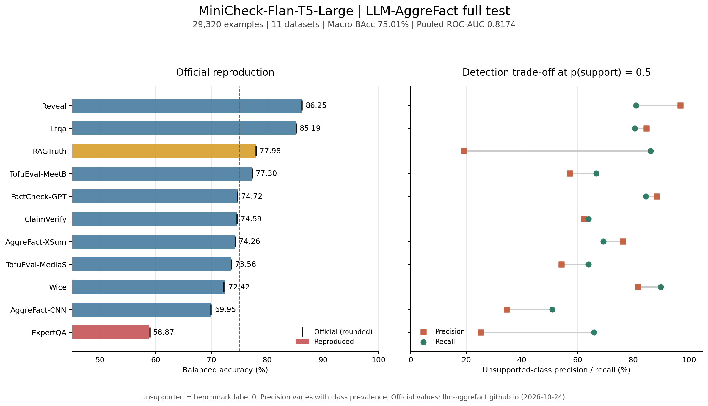

# MiniCheck 复现结果分析

分析日期：2026-10-24。基于已保存的预测重新计算指标，没有重新运行模型推理。原始文件保留在本地 `outputs/minicheck_reproduction/{benchmark,smoke}/`；此目录归档运行配置、指标和图表，原始文件的 SHA-256 见 [source_artifacts.sha256](source_artifacts.sha256)。

运行方法见 [MiniCheck 复现指南](../../项目资料/MiniCheck复现指南.md)。离线分析入口已整理到 [scripts/analyze_minicheck.py](../../scripts/analyze_minicheck.py)，在仓库根目录运行：

```bash
python scripts/analyze_minicheck.py --skip-plots
sha256sum -c results/minicheck/source_artifacts.sha256
```

分析命令读取本地完整预测并将新产物写入 `outputs/minicheck_reproduction/analysis/`，不会自动更新本目录的已归档结果。仅有仓库内的摘要无法重新计算逐条预测指标；新机器需按指南获得数据访问权限并完成评测。

## 1. 结论

**公开权重的推理与官方基准评测复现成功。** 完整 LLM-AggreFact test 集包含 29,320 条记录、11 个子数据集；各子数据集等权平均 BAcc 为 **75.0093%**，与作者榜单公布的 **75.0%** 一致到其展示精度。全部子数据集与公开四舍五入值的差异均小于 0.22 个百分点，满足项目提出的 ±2 个百分点复现检查目标。

当前结果支持“MiniCheck baseline 已完成官方基准复现”，尚不支持“RAG-HD 幻觉检测目标已经完成”：输出中没有项目挑战集、自评置信度基线、三个划分/训练种子的比较结果，也无法据此计算项目要求的 AUC 绝对提升 0.10。

## 2. 完整性与协议核查

- Smoke 两条预测为 `[1, 0]`，支持分数分别为 `0.98059237`、`0.00712132`，与官方示例一致。
- 实际预测行数与配置中的 `evaluated_rows`、`test_rows_total` 均为 29,320；11 个分组名称与官方榜单一致。
- `row_index` 从 0 连续到 29,319；标签、概率范围、文档和 claim 非空检查均通过。
- 所有预测标签均严格满足 `support_probability > 0.5` 时为 1，否则为 0。
- 从逐条预测重算的所有分组 BAcc、平均 BAcc，与 `metrics.csv` 的最大差异为 **0**。
- 模型、数据集、MiniCheck 代码提交和主要依赖版本均已记录。模型为 `lytang/MiniCheck-Flan-T5-Large`，并非 Notebook 默认的 Bespoke-MiniCheck-7B。
- 以上核查证实保存文件之间一致；本次未重新下载源数据或执行推理，不能将文件内部核查等同于独立重跑。

## 3. 与官方结果比较

BAcc 是支持类召回率与不支持类召回率的平均值。`Average` 对 11 个子数据集等权，不能替换成按样本数加权或全部样本混合后的指标。

官方参考：[LLM-AggreFact Leaderboard](https://llm-aggrefact.github.io/)，2026-10-24 查阅的 MiniCheck-Flan-T5-L 行。官方结果只展示一位小数，下面的小幅差值不能解释为方法提升。

| 子数据集 | 样本数 | 本次 BAcc % | 官方 BAcc % | 差值：百分点 | 本次 ROC-AUC |
| --- | ---: | ---: | ---: | ---: | ---: |
| AggreFact-CNN | 558 | 69.95 | 69.9 | +0.050 | 0.7500 |
| AggreFact-XSum | 558 | 74.26 | 74.3 | -0.035 | 0.7972 |
| ClaimVerify | 1,088 | 74.59 | 74.6 | -0.011 | 0.8084 |
| ExpertQA | 3,702 | 58.87 | 59.0 | -0.131 | 0.6177 |
| FactCheck-GPT | 1,566 | 74.72 | 74.7 | +0.016 | 0.8412 |
| Lfqa | 1,911 | 85.19 | 85.2 | -0.013 | 0.9312 |
| RAGTruth | 16,371 | 77.98 | 78.0 | -0.023 | 0.8613 |
| Reveal | 1,710 | 86.25 | 86.2 | +0.046 | 0.9373 |
| TofuEval-MediaS | 726 | 73.58 | 73.6 | -0.017 | 0.8111 |
| TofuEval-MeetB | 772 | 77.30 | 77.3 | +0.004 | 0.8486 |
| Wice | 358 | 72.42 | 72.2 | +0.217 | 0.8364 |
| 子数据集等权平均 | 29,320 | **75.01** | **75.0** | **+0.009** | **0.8219** |

差值由未四舍五入的本次分数计算，故可能与展示值相减略有不同。AUC 为本次补算指标，最后一行是各组 AUC 等权平均，并非混合全部样本的 AUC。

最强的两组为 Reveal、Lfqa；最弱的 ExpertQA 与公开值也接近。因此，ExpertQA 的低分首先体现该固定模型在此组上的局限，没有证据将它归因于本次复现失败。各组差异的具体成因仍需进一步按错误类型人工标注验证。

## 4. 混合全部样本后的结果

| 指标 | 结果 |
| --- | ---: |
| Accuracy / 单标签分类 Micro-F1 | 72.35% / 0.7235 |
| Pooled BAcc | 74.71% |
| Macro-F1：对两个标签等权 | 0.6785 |
| ROC-AUC | 0.8174 |
| 不支持类 AP | 0.5786 |
| 不支持类 Precision | 43.17% |
| 不支持类 Recall | 78.95% |

AP 为非插值 average precision，不是梯形积分 PR-AUC。本次补算 ROC-AUC 同时使用平均秩公式和经验 ROC 曲线积分交叉核对，12 组结果（11 个子集及 pooled）的最大差异约为 `3.3e-15`。

混淆矩阵采用原始支持标签：

| 真实标签 \ 预测标签 | 不支持 0 | 支持 1 |
| --- | ---: | ---: |
| 不支持 0 | 5,122 | 1,366 |
| 支持 1 | 6,742 | 16,090 |

全部样本中，支持类占 77.87%。若始终预测为支持，Accuracy 也会达到 77.87%，高于当前 72.35%，但 BAcc 只有 50%，不支持类召回为 0。这说明本任务不能单看 Accuracy；当前模型以较多误报换取了不支持样本的检出能力。

RAGTruth 占全部记录的 55.84%，混合指标受其影响较大；官方的子集等权平均降低了单个大数据集的权重。两类统计口径应同时说明。

## 5. 对幻觉检测最有用的发现

这里用“不支持类”作为证据一致性检测的目标类，原始 `label=0` 视为目标正类、风险分数为 `1-support_probability`。不受给定证据支持不等同于现实世界中必然为假，也不能直接作为项目挑战集的真实标签。

### 5.1 RAGTruth：检出率高，误报多

- 不支持类仅 1,269 条，占 **7.75%**；真实支持类 15,102 条。
- 检出不支持样本 1,095 条，漏检 174 条，Recall 为 **86.29%**。
- 4,581 条支持样本被判成不支持，对支持类的误报率为 **30.33%**。
- 共发出 5,676 次“不支持”判断，Precision 仅 **19.29%**，约五次报警中四次不符合真实标签。
- ROC-AUC 为 **0.8613**，不支持类 AP 为 **0.3716**。排序仍有区分能力，但固定阈值下的报警质量不足。

类比例与支持类误报共同导致低 Precision，不能仅归因于类别不平衡。接入 RAG-HD 后应在项目验证集上选择阈值，同时报告 ROC-AUC、AP、Precision 和 Recall，不能因复现使用 0.5 就直接固定项目阈值。

### 5.2 ExpertQA：判别能力和阈值表现均弱

- BAcc **58.87%**、ROC-AUC **0.6177**，说明它不仅是阈值选择问题，排序区分能力也有限。
- 2,971 条支持样本中有 1,432 条被拒绝，支持类 Recall 仅 **51.80%**。
- 不支持类 Precision **25.18%**，Recall **65.94%**。

这组值得优先做人工失败分析：核查隐含推理、跨句证据整合、实体关系及标注一致性。现有结果没有为这些候选原因提供系统的因果验证。

### 5.3 支持分数不宜直接当作已校准概率

全部样本中，支持分数不超过 0.1 的记录有 8,075 条，其中 3,893 条真实标签仍为支持；该极低分区间的“不支持”判断正确率只有 **51.79%**。

RAGTruth 中这一现象更明显：3,470 条低分记录里有 2,538 条实际受支持，只有 **26.86%** 属于不支持。低分不能直接表述为“至少 90% 的概率存在幻觉”。高分也存在明确的关系错误漏判，见下一节。

## 6. 可复查的错误案例

以下 `row_index` 均为 JSONL 中保存的零基索引，文件物理行号为索引加 1。完整文档可在原始预测中按索引查阅。

1. **主体关系反转仍被高分接受：RAGTruth，row_index=16926。** 文档描述 EEOC 起诉 Dollar General；claim 却说该员工被 EEOC 起诉。真实标签为不支持，模型支持分数 **0.982335**。这说明高词汇重合不能保证主体关系被正确核验，也为后续“实体角色/关系一致性”消融提供了具体动机；单个案例不能证明总体错误占比。
2. **证据原文出现仍被拒绝：RAGTruth，row_index=28836。** claim 是关于种植土豆的“挖约 4 英寸宽、6 至 8 英寸深的沟”。相同表述可在文档中找到，真实标签为支持，但模型支持分数为 **0.160038**。原始文档包含 377 个空白分词，不应将此例直接归因为文档过长。
3. **长文档中相关信息分布较散：Wice，row_index=2721。** claim 涉及 Serena/Blair 的发色和 Meester 染发，原文相关信息分布在不同位置。真实标签为支持，支持分数仅 **0.014816**，文档约 6,028 个空白分词。这与跨片段证据整合困难相符，但当前结果未保留 `used_chunks` 或每块分数，无法据此确定失败由切块、局部蕴含还是其他因素导致。

本地 `outputs/minicheck_reproduction/analysis/error_examples.jsonl` 另外保存了每个子集两类错误各最多两条、共 44 条高置信错误，包含完整输入。这是定向挑选的案例集，不代表随机抽检，不能用其占比估计总体错误类型分布。

## 7. 重复输入与标签冲突

- 29,320 条记录对应 **29,118 个不同文档–claim 对**、8,331 个不同文档。
- 169 组输入出现重复，超出首次出现的重复记录共 **202 条**。
- **9 组完全相同的文档–claim 对具有不同标签，涉及 19 条记录**。仅凭这两个文本输入的确定性分类器，在这些冲突组上至少会错 9 条。
- 相同输入的模型支持分数均一致到 `1e-6` 范围，没有发现重复输入预测不一致。

例如 TofuEval-MeetB 的 `row_index=1722/1723` 输入相同、标签分别为 0 和 1；RAGTruth 的 `25689/25714/25721` 输入相同、标签为 0/1/1。详见本地 `outputs/minicheck_reproduction/analysis/conflicting_inputs.json`。

这些冲突可能反映上游标注或转换口径差异，本次无法追溯其成因，不能直接断定原始数据损坏。为了保持官方可比性，**全部记录都保留在主指标中**。冲突规模很小，无法解释 ExpertQA 或 RAGTruth 的大量错误。后续项目挑战集应按原始问题/文档分组划分，避免相关记录进入不同数据划分。

## 8. 效率与可复现性边界

配置记录的运行时间为北京时间 **2026-10-23 18:34:10 至 21:39:09**，约 **3 小时 4 分 59 秒**；GPU 为 NVIDIA GeForce RTX 3090，batch size 为 1。

按整个记录时间计算，平均约 **2.64 条/秒、158.5 条/分钟**。这个时间包含模型初始化、数据加载与文件保存等开销，不是纯推理吞吐，也不是单请求延迟。输出未记录峰值显存，不能据此证明项目的 ≤12 GB 显存约束已经满足。

公开权重的固定基准推理不需要仅为凑随机种子重复三次。项目后续三个种子的分组划分/判别器训练可以复用固定生成结果和 MiniCheck 特征缓存；均值、标准差、成对比较应在相同的项目测试样本上产生。

复现指南已同步本次实际进度；其中的 NLTK 目录/代理排查、数据集授权和终端认证步骤仍保留，供其他机器重建环境时使用。

## 9. 下一步优先级

1. 保留当前原始预测与版本记录，将本次结果作为“公开权重推理与评测复现”的基准。
2. 在 RAG-HD 的相同证据、相同生成回答上提取句子支持分数，再按项目协议聚合成回答级风险。官方基准没有自动应用项目的跨句 MIN 聚合，二者应分开记录。
3. 在三个分组划分/训练种子下，同场比较自评置信度、MiniCheck 和改进方法；报告 ROC-AUC/AP、分类指标及差值，阈值只由验证集确定。
4. 优先围绕关系反转、高词汇重合、跨片段证据与误报做错误标注和消融；三类挑战“检索失败/证据冲突/答案过时”需使用项目自己的分组标签，不能从当前 11 个子集名字推断。

## 附件



- [PNG 图表](analysis/results_overview.png) / [SVG 矢量图](analysis/results_overview.svg)。
- [extended_metrics.csv](analysis/extended_metrics.csv)：11 个子集及 pooled 的补充指标、混淆矩阵、公开值差异。
- [summary.json](analysis/summary.json)：完整性核查、耗时、模型分数区间切片与文本长度切片。
- [benchmark/metrics.csv](benchmark/metrics.csv) / [benchmark/run_config.json](benchmark/run_config.json)：原始评测分组指标与运行配置。
- [smoke/predictions.jsonl](smoke/predictions.jsonl) / [smoke/run_config.json](smoke/run_config.json)：官方两条样例及运行记录。
- [source_artifacts.sha256](source_artifacts.sha256)：本地原始 benchmark / smoke 文件的校验清单。
- [scripts/analyze_minicheck.py](../../scripts/analyze_minicheck.py)：离线重算脚本；数值计算使用标准库，绘图需要 Matplotlib。本地生成的 `conflicting_inputs.json`、`error_examples.jsonl` 含完整输入，不纳入本目录摘要。
