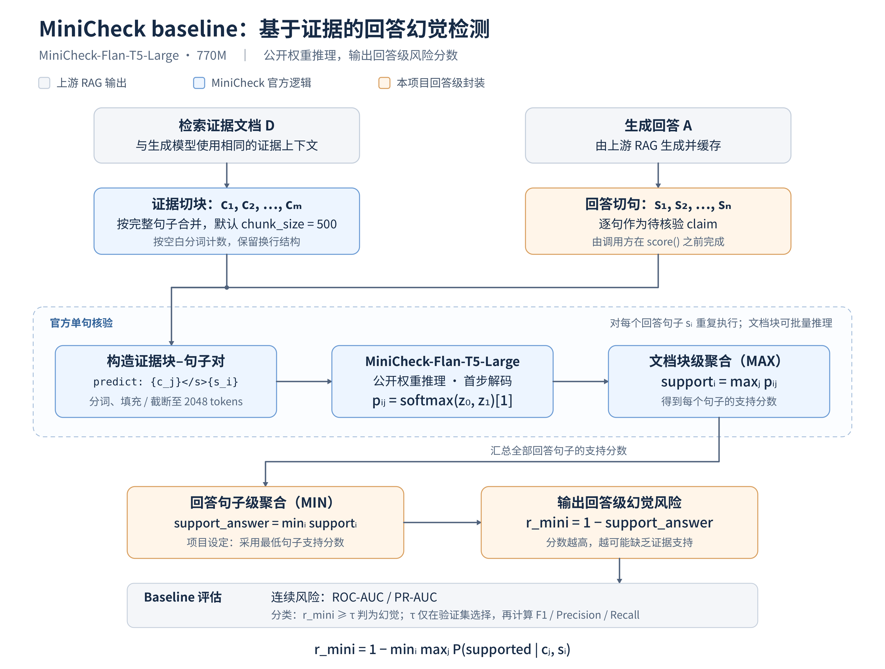
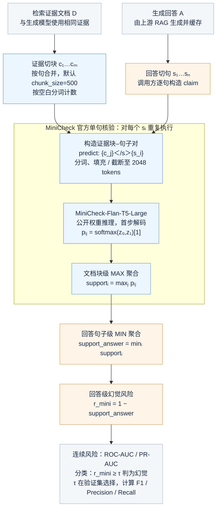

# MiniCheck baseline 流程图

本图依据仓库内 MiniCheck 实现及《C09_项目实施指导》10.2 节绘制，展示 **MiniCheck-Flan-T5-Large（770M）在本项目中的推理流程**。

可编辑矢量图：[minicheck_baseline.svg](minicheck_baseline.svg)。PNG 为 3200 × 2420 像素，可用于报告或 PPT。

## 可编辑 Mermaid 源码

## 聚合公式与方法边界

设文档块为 $c_1,\ldots,c_m$，回答句子为 $s_1,\ldots,s_n$：

$$
p_{ij}=P_\theta(\mathrm{supported}\mid c_j,s_i),\qquad
\mathrm{support}_i=\max_j p_{ij},\qquad
r_{\mathrm{mini}}=1-\min_i\mathrm{support}_i.
$$

- **官方模型的输出是支持分数**：对同一句子的各个文档块取最大值。其默认句子标签为 `support_i > 0.5` 时支持，否则不支持。
- **回答切句与跨句 MIN 聚合由本项目封装完成**：官方 `score()` 不会自动切分多句 claim，也没有固定的回答级聚合规则。因此，跨句 MIN 不能表述为 MiniCheck 官方默认算法。
- **分数方向**：`support_i` 越高表示证据支持越强，`r_mini` 越高表示回答级幻觉风险越高。风险分数用于 ROC-AUC / PR-AUC；分类阈值在验证集确定。
- **证据组织**：若检索返回多篇证据，可按固定顺序组成文档 D；图示采用一个证据上下文核验多个回答句子的接口。应与生成模型的可见证据保持一致，并在实验配置中记录组织方式。
- **模型输入**：Flan-T5 的实际输入格式为 `predict: {document_chunk}</s>{claim}`；默认输入上限为 2048 tokenizer tokens。`chunk_size=500` 的计数方式为 Python `split()`，是空白分词数。
- **分数计算**：代码取首步解码的两个类别 logits（token ID 为 3 和 209），做二分类 softmax，取 supported 类分数；无需生成完整解释文本。
- **推理与训练**：本图展示加载公开权重后的 baseline 推理。仓库中的 C2D / D2C 合成数据流程属于原方法的训练数据构建，不参与本图所示的单样本核验过程。

## 报告图注建议

**图 X　MiniCheck baseline 推理流程。** 使用公开的 MiniCheck-Flan-T5-Large 权重，对证据文档块与回答句子进行支持性核验。官方实现对文档块支持分数取最大值，得到句子级支持分数；本项目对回答句子的支持分数取最小值，并通过 $r_{\mathrm{mini}}=1-\min_i\max_j p_{ij}$ 转换为回答级幻觉风险，用于统一的幻觉检测评估。

## 仓库依据

- [MiniCheck 官方接口与默认分类规则](../../baselines/MiniCheck/minicheck/minicheck.py)：`score()`、`_score_inferencer()`。
- [文档切块、Flan-T5 推理与 MAX 聚合](../../baselines/MiniCheck/minicheck/inference.py)：`inference_per_example()`、`batch_tokenize()`、`inference()`。
- [MiniCheck 使用说明](../../baselines/MiniCheck/README.md)：Usage 部分。
- [本项目 baseline 设定](../C09_项目实施指导.md)：10.2 节的句子级 MIN 聚合，以及 12.3 节的验证集阈值选择。
